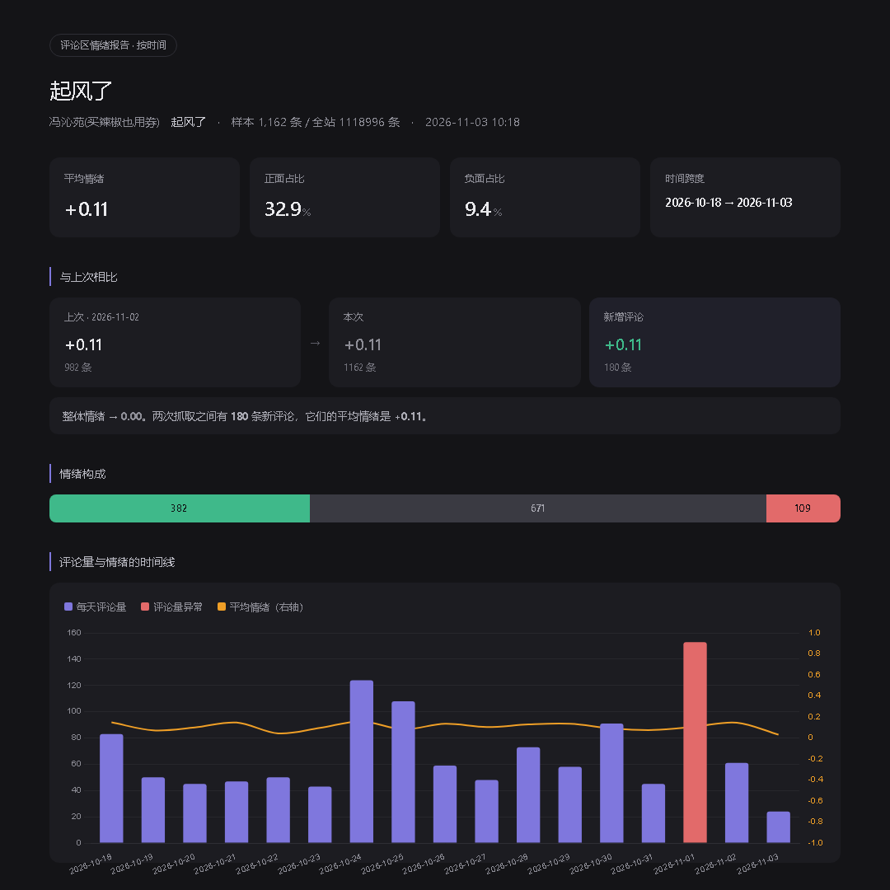

# ncm-radar

> 网易云评论区情绪雷达 —— 抓评论、算情绪、出时间线。

输入一个歌名，拉取这首歌的最新评论，输出一份带情绪曲线和异常检测的 HTML 报告。



## 这是什么

网易云的评论区是个很特别的地方。同一首歌下面，有人在许愿、有人在怀旧、有人在深夜倾诉。这些内容按时间铺开之后，会呈现出一些肉眼看不出来的结构：某一天评论量突然翻倍、某段时间情绪整体下沉、某几个词反复出现暗示着听众的构成。

`ncm-radar` 做的就是把这些结构画出来。

它不是爬虫框架，也不做批量抓取。一次分析一首歌，几百到几千条评论，出一份报告。

## 能做什么

- **情绪时间线** —— 按天聚合评论量，叠加平均情绪曲线，异常日标红
- **异常检测** —— 评论量或情绪偏离均值超过 2 个标准差的日子自动标记
- **评论区画像** —— 用高频词反推评论区形态：许愿墙 / 怀旧现场 / 夸赞现场 / 深夜倾诉 / 打卡现场
- **每日对比** —— 用 commentId 做差集，算出两次抓取之间新增了哪些评论，单独统计它们的情绪
- **高频词** —— jieba 分词后统计，过滤虚词和表情标签

报告是单文件 HTML，自带 Chart.js，直接浏览器打开就能看。

## 安装

```
pip install -r requirements.txt
```

需要 Python 3.8+。

## 用法

单次分析：

```
python -m ncm_radar 起风了
python -m ncm_radar 晴天 --count 3000 --pick 1
```

Windows 用户可以直接双击 `跑一下.bat`。

参数：

- `--count` 抓取条数，默认 400
- `--pick` 直接指定搜索结果序号，跳过交互
- `--delay` 请求间隔秒，默认 0.5
- `--out` 报告输出目录，默认 `reports/`
- `--no-compare` 关掉历史对比

## 每日追踪

第一次跑的时候加 `--track`，这首歌就进了追踪列表：

```
python -m ncm_radar 起风了 --track --pick 1
```

之后每天跑一次：

```
python -m ncm_radar --run-all --count 1200
```

它会依次抓列表里所有歌，并自动和上一次对比。

```
python -m ncm_radar --list                # 看列表
python -m ncm_radar --untrack <歌曲id>     # 移除
```

设成每天自动跑（Windows 任务计划程序）：

```
schtasks /create /tn "ncm-radar" /tr "cmd /c cd /d <项目路径> && python -m ncm_radar --run-all --count 1200" /sc daily /st 09:00
```

## 输出

每次运行产出两个文件：

- `reports/<歌名>_<日期>.html` —— 报告
- `reports/<歌名>_<日期>.json` —— 原始数据，方便二次分析

## 实现要点

做这个东西踩了几个坑，记下来供参考。

**weapi 加密。** 接口参数不是明文传的，要过两轮 AES-128-CBC 再套一层 RSA。第一轮 key 固定（`0CoJUm6Qyw8W8jud`），第二轮 key 随机 16 字符，这个随机 key 再用 RSA 公钥加密成 `encSecKey`。实现在 `crypto.py`，不到 40 行。

**分页限制。** 评论接口的 `offset` 到 200 就被服务端拒绝（返回 code 400），但响应里的 `cursor` 字段可以一直往回翻，每页 20 条且不重复。所以只用 cursor 接力。老接口 `/weapi/v1/resource/comments/` 已经废弃，返回空数组。

**情绪词典要按语域重写。** 通用中文情感词典在这里会失灵：「破防」「泪目」「emo」在标准词典里是负面词，在网易云评论区却是被感动到的高强度正面。`sentiment.py` 里的词典是按评论区语域重新标注的，另外单独处理了 `[哭哭]` 这类表情标签——标签必须先剔出文本，否则里面的「强」「弱」会被情感词误匹配。

**对比要用差集。** 两次抓的都是「最新 N 条」，样本大量重叠，直接比平均分没有意义。必须用 commentId 取集合做差，得到的才是真正新增的评论。

**系统占位评论要过滤。** 约 3% 的评论是 `[发布了语音，请前往最新移动端版本查看]` 这类占位文本，不滤掉会污染词频统计。

## 已知限制

- **只能抓到最新的一段。** cursor 从最新往回翻，热门歌一天上百条，抓 1500 条大概覆盖两三周。想看几年跨度得抓几万条，不现实。
- **中性占比偏高（约 55%）。** 评论区有大量「接」「99」「考古」这类打卡内容，本来就无情绪。剩下的一部分是叙事型评论，情绪藏在情节里，词典法抓不到。
- **超大评论区可能拿不全。** 评论数接近两百万的歌，翻到几年前就断了，服务端对超大评论区有单独限制。
- **情感打分是规则法，不是模型。** 准确率够看趋势，不适合逐条判断。

## 免责声明

本项目仅用于个人学习和数据分析，抓取的是公开可见的评论区内容。

- 只读，不登录、不发请求修改任何数据、不做自动化互动
- 默认请求间隔 0.5 秒，请不要调低
- 请遵守网易云音乐的用户协议和 robots 协议
- 抓取的数据请勿用于商业用途或公开发布他人信息

因使用本项目产生的一切后果由使用者自行承担。

## License

MIT
